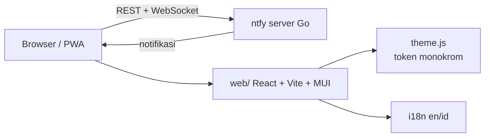

# remindme

**Web client pengingat — turunan ntfy dengan identitas visual dan bahasa sendiri.**

Repo ini adalah fork dari [ntfy](https://github.com/binwiederhier/ntfy) (Apache License 2.0). Backend Go dan protokolnya masih ntfy; yang diubah adalah **lapisan tampilan**: palet monokrom, navigasi bawah simetris, empty state yang bisa ditindaklanjuti, dan pengurangan bahasa menjadi **English + Indonesia**.

> **Catatan penting:** repo ini adalah *klien web pengingat*, bukan aplikasi NotifApp. Untuk sistem alarm workshop offline-first (Android/iOS/desktop + server sendiri), lihat repo **notifapp**.

---

## Daftar Isi

- [Apa yang berubah dari ntfy](#apa-yang-berubah-dari-ntfy)
- [Arsitektur singkat](#arsitektur-singkat)
- [Menjalankan](#menjalankan)
- [Pengembangan web](#pengembangan-web)
- [Desain & tema](#desain--tema)
- [Internasionalisasi](#internasionalisasi)
- [Tes & pemeriksaan](#tes--pemeriksaan)
- [Atribusi & lisensi](#atribusi--lisensi)

---

## Apa yang berubah dari ntfy

| Area | Sebelum (ntfy) | Sekarang |
|---|---|---|
| Palet | Biru/ungu bawaan MUI | **Monokrom**: hitam sebagai primer di atas putih, permukaan near-black di dark mode (anti-silau) |
| Radius | Default (4 px) | **14 px** — terasa lebih lembut dan modern |
| Navigasi mobile | `BottomNavigation` MUI (padding `.Mui-selected` membuat 25% kolom tidak simetris) | **CSS Grid `repeat(4, 1fr)`** + pill indikator aktif + ikon outlined |
| Navbar | Putih menyilaukan di dark mode | Permukaan transparan + `backdrop-filter: blur(20px)` + garis pemisah tipis |
| Empty state | Teks kosong tanpa aksi | Tipografi terpusat + CTA **"+ Subscribe to topic"** yang membuka `SubscribeDialog` |
| Judul dokumen | Tertimpa `updateTitle` | Tetap **"remindme"** |
| Bahasa | 53 locale | **2 locale**: `en`, `id` (51 berkas locale dihapus; precache service worker ikut mengecil) |
| Dev server | localhost saja | `host: "0.0.0.0"` untuk pengujian dari HP di LAN |

Perubahan ini **tidak menyentuh logika bisnis**: pengiriman notifikasi, polling, langganan topik, dan API tetap milik ntfy.

---

## Arsitektur singkat



| Bagian | Isi |
|---|---|
| `main.go`, `cmd/` | Server & CLI Go (ntfy) |
| `server/`, `user/`, `topic/`, `message/` | Inti layanan push ntfy |
| `web/` | Klien React — **satu-satunya bagian yang diubah di fork ini** |
| `web/src/components/theme.js` | Token desain monokrom (light + dark) |
| `web/src/app/i18n.js` | Konfigurasi bahasa: hanya `en` + `id` |
| `docs/` | Dokumentasi MkDocs |

---

## Menjalankan

### Server (Go)

```bash
make build          # build web + docs + cli
./ntfy serve        # default :80, gunakan --listen-http untuk port lain
```

Prasyarat mengikuti repo ntfy: Go sesuai `.go-version` (1.27.3), Node.js untuk `web/`, Python untuk `docs/`.

### Klien web saat pengembangan

```bash
cd web
npm install
npm run dev         # http://0.0.0.0:3000
```

Dev server terbuka di `0.0.0.0` supaya bisa dibuka dari HP pada jaringan yang sama (mis. `http://192.168.x.x:3000`).

### Build produksi web

```bash
cd web
npm run build       # hasil di web/build, disajikan server Go
```

---

## Pengembangan web

```bash
cd web
npm run dev      # Vite dev server
npm run build    # build produksi
npm run lint     # ESLint
npm run test     # Vitest
```

Struktur yang perlu diketahui:

- `web/src/app/` — API client, polling, koneksi, preferensi, i18n
- `web/src/components/` — komponen UI, termasuk `theme.js` dan `MobileTabBar`
- `web/public/static/langs/` — hanya `en.json` dan `id.json`

---

## Desain & tema

Token desain berada di `web/src/components/theme.js`:

| Token | Light | Dark | Alasan |
|---|---|---|---|
| Latar | `#f7f7f8` | `#0b0b0d` | Dark memakai near-black agar daftar notifikasi panjang tidak menyilaukan |
| Permukaan | `#ffffff` | `#161618` | Pemisahan kartu tanpa bayangan berat |
| Primer | hitam | putih lembut | Netral, tidak bersaing dengan warna semantik |
| Radius | 14 | 14 | Konsisten di kartu, dialog, dan pill |
| Tipografi | Roboto | Roboto | Bobot 600 untuk judul, `textTransform: none` pada tombol |

Warna semantik (merah error, ikon prioritas) **tetap berwarna** — warna di sini menandai urgensi, bukan dekorasi.

Navigasi bawah di `web/src/components/Navigation.jsx` memakai CSS Grid `repeat(4, 1fr)`, bukan komponen MUI `BottomNavigation`, karena `BottomNavigation` menyisipkan padding pada item terpilih sehingga empat kolom tidak pernah benar-benar 25%.

---

## Internasionalisasi

```js
supportedLngs: ["en", "id"],
fallbackLng: "en",
debug: false,
```

- Berkas terjemahan: `web/public/static/langs/en.json` dan `id.json`.
- 51 locale lain dihapus untuk mengecilkan precache service worker.
- Preferensi bahasa di Pengaturan hanya menampilkan dua pilihan.
- Kontrak ini dijaga oleh `web/src/app/i18n.test.js` dan `e2e/settings.spec.js`.

Menambah bahasa baru berarti: tambah JSON, daftarkan di `supportedLngs`, tambah opsi di Preferences, dan perbarui kedua tes tersebut.

---

## Tes & pemeriksaan

Perintah yang sudah ada di repo:

```bash
# Klien web — unit test
cd web && npm test

# Lint
cd web && npm run lint

# Build (memastikan bundle & PWA masih valid)
cd web && npm run build

# E2E (Playwright)
cd web && npm run test:e2e
```

E2E memakai Playwright melalui skrip yang sudah ada:

```bash
cd web && npm run test:e2e
```

Untuk backend Go, gunakan target Makefile yang sudah ada:

```bash
make test      # cli-test + web-test
make check     # fmt, vet, lint, staticcheck, template-check, go-check
```

---

## Atribusi & lisensi

Repo ini adalah **fork** dari proyek [ntfy](https://github.com/binwiederhier/ntfy) karya Philipp C. Heckel.

- Lisensi asli: **Apache License 2.0** (lihat [`LICENSE`](LICENSE)); [`LICENSE.GPLv2`](LICENSE.GPLv2) disertakan sesuai distribusi upstream.
- Hak cipta dan atribusi upstream dipertahankan. Perubahan pada fork ini terbatas pada lapisan tampilan web (tema, navigasi, empty state, bahasa) dan branding aplikasi web.
- Nama "remindme" adalah branding fork ini; nama dan logo ntfy tetap milik pemiliknya.

Jika kamu mendistribusikan ulang, pertahankan berkas lisensi dan atribusi upstream.
