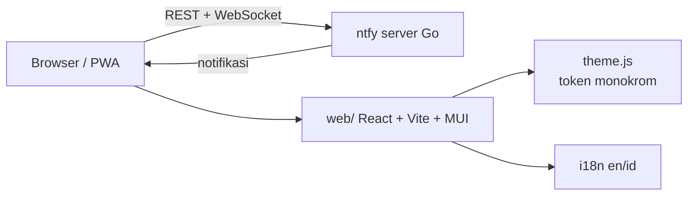

# remindme

**Web client pengingat — turunan ntfy dengan identitas visual dan bahasa sendiri.**

Repo ini adalah fork dari [ntfy](https://github.com/binwiederhier/ntfy) (Apache License 2.0). Backend Go dan protokolnya masih ntfy; yang diubah adalah **lapisan tampilan**: palet monokrom, navigasi bawah simetris, empty state yang bisa ditindaklanjuti, dan pengurangan bahasa menjadi **English + Indonesia**.

> **Catatan penting:** repo ini adalah *klien web pengingat*, bukan aplikasi NotifApp. Untuk sistem alarm workshop offline-first (Android/iOS/desktop + server sendiri), lihat repo **notifapp**.

---

## Daftar Isi

- [Apa yang berubah dari ntfy](#apa-yang-berubah-dari-ntfy)
- [Arsitektur singkat](#arsitektur-singkat)
- [Menjalankan](#menjalankan)
- [Pengembangan web](#pengembangan-web)
- [Desain & tema](#desain--tema)
- [Internasionalisasi](#internasionalisasi)
- [Tes & pemeriksaan](#tes--pemeriksaan)
- [Atribusi & lisensi](#atribusi--lisensi)

---

## Apa yang berubah dari ntfy

## Chat/forum
There are a few ways to get in touch with me and/or the rest of the community. Feel free to use any of these methods. Whatever
works best for you:

Perubahan ini **tidak menyentuh logika bisnis**: pengiriman notifikasi, polling, langganan topik, dan API tetap milik ntfy.

---

## Arsitektur singkat



| Bagian | Isi |
|---|---|
| `main.go`, `cmd/` | Server & CLI Go (ntfy) |
| `server/`, `user/`, `topic/`, `message/` | Inti layanan push ntfy |
| `web/` | Klien React — **satu-satunya bagian yang diubah di fork ini** |
| `web/src/components/theme.js` | Token desain monokrom (light + dark) |
| `web/src/app/i18n.js` | Konfigurasi bahasa: hanya `en` + `id` |
| `docs/` | Dokumentasi MkDocs |

---

## Menjalankan

### Server (Go)

```bash
make build          # build web + docs + cli
./ntfy serve        # default :80, gunakan --listen-http untuk port lain
```

Prasyarat mengikuti repo ntfy: Go sesuai `.go-version` (1.27.3), Node.js untuk `web/`, Python untuk `docs/`.

### Klien web saat pengembangan

```bash
cd web
npm install
npm run dev         # http://0.0.0.0:3000
```
